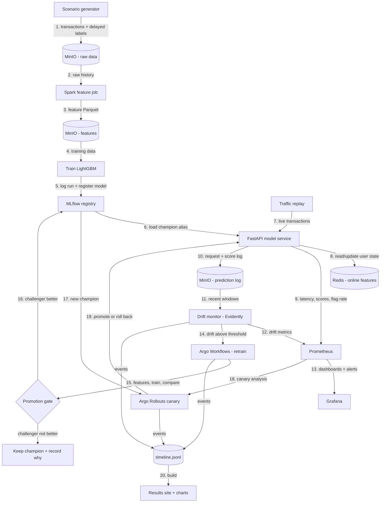

# Fraud Model Lifecycle: Project Plan

> **For Claude Code:** this plan runs under the `/autonomous-build` skill. The skill holds the general working rules; this file adds what is specific to this project. **Where this plan and the skill disagree, this plan wins.** Section 1.3 (resources and where things run) overrides everything else in this file.

---

## 0. Before you start (for Charlie, not Claude Code)

**Personal computer only**, never a work laptop. Personal time and equipment.

This project costs **$0**: no cloud, no GPU, no API keys. Everything runs locally in Docker Desktop.

1. **Docker Desktop running.** Nothing else to configure: Claude Code checks how much memory Docker has and adapts (Section 1.3).
2. **GitHub CLI** logged in with workflow scope (already done for earlier projects). If unsure: `gh auth refresh -s workflow`.
3. **Launch:** open `C:\dev\fraud-model-lifecycle` (this file inside) in VS Code. In the integrated terminal:
   ```powershell
   Remove-Item Env:ANTHROPIC_API_KEY -ErrorAction SilentlyContinue
   claude --dangerously-skip-permissions
   ```
   Then send: `/autonomous-build fraud-model-lifecycle-plan.md`

   `--dangerously-skip-permissions` lets Claude Code run any command without asking. That is why this runs on your personal machine, and why Sections 1.3 and 1.4 limit what it may do.
4. **At the end:** read `docs/HANDOFF.md`, answer the questions in one line ("go with your recommendations" works), then follow the pre-public checklist in it.

**If it stops** (usage limit, crash, PC off): send `/autonomous-build` again. It resumes from `docs/PROGRESS.md`. Claude Code does not resume by itself after a usage limit resets.

---

## 1. Project-specific rules (on top of the skill)

### 1.1 Autonomy and decision log
- Never pause to ask Charlie mid-run. Pick the most reasonable option, log it, keep going.
- `docs/DECISIONS.md` format: `Decision | Options considered | Why | Easy to change? (yes/no)`.
- `docs/QUESTIONS_FOR_CHARLIE.md`: each question with your recommendation and what you did meanwhile.
- `docs/PROGRESS.md`: updated after every step with the exact next step.
- Blocker fallbacks:
  - A Helm chart or tool won't install: use the fallback in Section 5, log it, continue.
  - A component can't fit in memory: apply the memory plan in Section 1.3, then drop the lowest-priority component listed there.
  - A test fails after honest tries: mark it `xfail` with a reason (never delete tests), log it, continue.
  - A push is rejected: keep committing locally, retry at the next push point. Never force-push.
- Work milestones in order; finish each "Done when" before moving on. Stretch items only after the last milestone, in order.
- Look up version-sensitive facts (chart versions, CLI flags, library APIs) in current official docs. Pin versions in config.
- Simple, readable code: a reviewer should understand any file in under a minute.

### 1.2 Checkpoints (power outage, crash, PC off)
- Commits are local and frequent: after every passing step, after every experiment run (results first), and a `wip:` commit at least every 30 minutes.
- Pushes are occasional: at every milestone end, and at least every 2 hours if there are unpushed commits.
- Messages: `M<n>: <what>`, `wip: <what>`, `wip: recovered after interruption`.
- Run `fml test` and `fml lint` before every commit from M1 on.
- **On restart:** `git status`, commit half-finished work (never discard), then check the cluster state (`kind get clusters`, `kubectl get pods -A`) and repair or recreate it with `fml up` before continuing.
- Experiment runs are resumable: each finished (scenario, policy, seed) result is saved as it completes; reruns skip finished ones.

### 1.3 Resources and where things run (highest priority)
- **Host:** plain Windows with Docker Desktop. **Do not install WSL or ask Charlie to.** Everything Linux runs in containers or in the `kind` cluster.
- **Python:** the host's global Python is 3.14. Do not use it. Create a `uv` project env on **Python 3.12** and run everything through it (`uv run fml ...`). Container images also use Python 3.12.
- **CLI tools** (kind, kubectl, helm, terraform, argo, kubectl-argo-rollouts): download pinned, checksum-verified binaries into a gitignored `.tools/` folder and call them from there. No admin rights, no `winget`, no system-wide installs, no UAC prompts.
- **Spark and Java** run only inside containers, never on the host.
- **Memory plan:** at M0, read Docker's available memory (`docker info`) and record it.
  - Every pod gets requests and limits; the whole platform must fit in **10 GB**.
  - If Docker has less than 10 GB, use the slim profile: single-replica everything, no Alertmanager UI, smaller Prometheus retention.
  - If still too tight, drop in this order: Argo Workflows UI, Grafana Loki (if added), Redis replica. Never drop the core loop (serve, monitor, retrain, promote).
- **Disk:** keep images small (slim bases, multi-stage builds). Docker cleanup is allowed: label everything `project=fraud-model-lifecycle`, remove those first, log any other cleanup. Never touch anything outside Docker.
- **Images** are built locally and loaded into kind (`kind load docker-image`). No image registry, no pushing images anywhere.
- **Long-running things are local and free,** but tidy: port-forwards and background processes are started by `fml` commands, tracked in a PID file, and stopped by `fml down`. At the end of the run, stop everything and leave `fml up` as the one command to bring it all back.
- Windows-safe tooling: a Python CLI (`fml`), not a Makefile; `pathlib`; files written from Python, not heredocs; `.gitattributes` with `* text=auto eol=lf`.

### 1.4 Secrets and security
- Local service passwords (Postgres, MinIO, Grafana admin) are generated randomly at `fml up` into `.env` (gitignored before the first commit) and passed to Kubernetes as Secrets. Never printed, logged, or committed. Ship `.env.example` with placeholders. Run `git status` before the first commit.
- All UIs and APIs are reached only through `kubectl port-forward` bound to `127.0.0.1`. No NodePorts or ingress exposed beyond localhost.
- No cloud resources, no deploys anywhere. Terraform only targets the local kind cluster.
- Treat downloaded charts and images as third-party: pin versions and digests, use official sources only.
- Screenshots and videos: headless browser only; no tokens, passwords, emails, or `C:\Users\...` paths visible.
- Before handoff: run a secret scanner (gitleaks in Docker) over the full git history and report the result.
- Employer boundary: nothing from Charlie's employer. All data is synthetic and generated by this repo.
- The repo stays **private**. Never change visibility or enable Pages.

### 1.5 Honest evaluation
- Freeze the scenario definitions, policies, seeds, metrics and the alert budget **before** running the policy comparison; log them in DECISIONS.md.
- Tune model settings and drift thresholds only on a **dev scenario set**; report results on a separate **test scenario set** with different seeds and drift timing.
- Run a **no-drift control scenario** to measure false drift alarms and unnecessary retrains.
- Every number comes with its seed spread (at least 5 seeds; report mean and min/max).
- Label delay is realistic: performance metrics only use labels that would have arrived by that simulated day.
- Report where drift-triggered retraining loses (e.g. retrains it didn't need, slower than a schedule on some scenario) as clearly as where it wins.
- Sanity-check impossible numbers (recall above 1, PR-AUC jumps on unchanged data, drift on the control scenario) before charting.
- Be clear on the README which numbers come from the fast backtest mode and which from the full Kubernetes loop (Section 3).

---

## 2. Goal

**Show the full life of a production ML model on a real (local) platform: build features, train, register, deploy with a canary, watch for drift, retrain automatically, and promote only when the new model is proven better.**

Skills it shows:
- **ML platform:** Kubernetes, Terraform, Helm, MLflow model registry, Argo Workflows, Argo Rollouts
- **Data engineering:** PySpark feature pipeline, training/serving feature parity
- **Model monitoring:** Evidently drift detection, Prometheus metrics, Grafana dashboards, alerting
- **Risk ML:** fraud detection with LightGBM, alert-budget metrics, label delay
- **Engineering judgment:** a measured comparison of retraining policies

**The project should look great.** Every piece feeds the portfolio site, slides, and video. Small scope, polished finish.

### One-line pitch
Fraud patterns change, and a model trained last month quietly gets worse. This project runs a fraud model's whole lifecycle on Kubernetes, catches the drift, retrains and safely rolls out a better model on its own, and measures whether that actually beats retraining on a schedule.

---

## 3. Scope

### In scope
1. **Synthetic transaction generator** (seeded): users, merchants, categories, devices, amounts, timestamps, fraud labels with several fraud patterns, and **label delay** (labels arrive days later). Scenario files switch on drift at set simulated days:
   - covariate drift (amounts creep up, a new merchant category appears)
   - concept drift (a new fraud pattern the model hasn't seen)
   - a no-drift control
2. **Feature pipeline:** PySpark (local mode, in a container) computes per-user rolling features for training and writes Parquet to MinIO. The model service computes the same features online from Redis. A **parity test** checks both give the same values on a sample.
3. **Training:** LightGBM, time-based splits, logged to MLflow; models registered with **aliases** (`champion`, `challenger`).
4. **Serving:** a FastAPI model service that loads the `champion` alias, computes online features, scores, and exposes Prometheus metrics (latency, score distribution, flag rate). Every request and score is logged for monitoring.
5. **Canary rollout:** Argo Rollouts shifts traffic to a new model in steps (e.g. 20%, 50%, 100%), with automatic analysis against Prometheus (error rate, latency) and automatic rollback.
6. **Monitoring:** a scheduled job computes Evidently data drift and prediction drift over recent windows, plus delayed-label performance once labels arrive. Results go to Prometheus and to stored HTML reports. Grafana dashboards and alert rules.
7. **Retraining workflow (Argo Workflows):** triggered by the drift monitor. Steps: gather the latest labeled window → Spark features → train challenger → compare challenger vs champion on the same recent holdout → **promotion gate** → register and set alias → start the canary rollout → promote or roll back. Every step's outcome is recorded.
8. **Traffic replay:** a simulator replays the scenario's transactions against the service in accelerated simulated time and writes a timeline of events.
9. **Policy comparison (the headline experiment):** no retraining vs scheduled retraining vs drift-triggered retraining, across the test scenarios and seeds.
   - **Fast backtest mode:** runs the same generator, feature, training, drift and gate code in-process (no Kubernetes) so every scenario, policy and seed can run in minutes.
   - **Full loop mode:** each drift scenario also runs once end to end on the Kubernetes platform, for the showcase timeline and screenshots, and to confirm the backtest matches.
10. **Infrastructure as code:** Terraform (kind, Helm and Kubernetes providers) creates the cluster and installs everything; `fml up` and `fml down` wrap it.
11. **Results site, charts, screenshots, video, and portfolio kit.**

### Out of scope
- Cloud deployment, managed Kubernetes, KServe/Knative/Istio, Kubeflow, real customer data, deep learning models, a public live demo.

---

## 4. Architecture



- `timeline.jsonl`: one event per line (simulated day, real time, type, details, links to reports).
- `results/backtest/*.json`: one file per (scenario, policy, seed) with daily metrics, retrain count, and environment versions.

---

## 5. Stack

| Piece | Choice | Fallback |
|---|---|---|
| Python | 3.12 via `uv` | none |
| Cluster | kind | Docker Desktop's built-in Kubernetes |
| Infra as code | Terraform (kind, helm, kubernetes providers) | OpenTofu (same code) |
| Object storage | MinIO | local PersistentVolume |
| Metadata DB | Postgres (MLflow backend) | SQLite inside MLflow |
| Model registry | MLflow (aliases) | none |
| Online features | Redis | in-memory with a single replica |
| Features | PySpark local mode in a container | pandas, if Spark can't fit in memory (log it) |
| Model | LightGBM | XGBoost |
| Serving | FastAPI + Uvicorn | none |
| Rollouts | Argo Rollouts (canary + Prometheus analysis) | ingress-nginx canary weights |
| Pipelines | Argo Workflows | Kubernetes Jobs |
| Drift | Evidently | own PSI/KS calculations |
| Metrics / dashboards | kube-prometheus-stack (Prometheus, Grafana, Alertmanager) | Prometheus + Grafana charts separately |
| CLI | `fml` (Typer) | none |
| Charts | matplotlib (PNG/SVG) + Plotly (interactive) | none |
| Site | static HTML + vanilla JS + Tailwind CDN | none |
| Screenshots / video | Playwright (headless, video recording) + ffmpeg in Docker | none |
| Quality | ruff, pytest, kubeconform, `terraform validate`, `helm lint`, GitHub Actions | none |

---

## 6. Visual design rules

Same base look as Bulwark, reachability-triage and llm-decode-kernels, with a new accent.

- **Dark theme.** Background `#0B0F17`, panels `#131A26`, borders `#1F2937`, text `#E5E7EB`, muted `#9CA3AF`.
- **Accent:** teal `#2DD4BF`.
- **Status colors:** healthy `#22C55E`, drift warning `#F59E0B`, drift alert or rollback `#EF4444`. Champion `#2DD4BF`, challenger `#A78BFA`.
- **Fonts:** Inter for UI, JetBrains Mono for numbers, IDs, and code (fallback to default sans in charts if not installed).
- **Product name and logo:** pick a short name and a simple SVG logo; log it in DECISIONS.md.
- **The star view: the lifecycle timeline** (site home page). One horizontal timeline of simulated days for a chosen scenario:
  - lines for fraud caught (%), PR-AUC (from delayed labels), and drift score
  - event markers: drift detected, retrain started, challenger trained, gate passed or failed, canary 20% / 50% / 100%, promoted, rolled back
  - clicking an event opens its details: the Evidently report, champion vs challenger metrics, rollout steps
  - a scenario switcher (amount drift, new category, new fraud pattern, control)
- **Charts** (PNG 1600px + SVG in `assets/charts/`, plus one interactive Plotly page; titles state the takeaway; colors never the only signal):
  - fraud caught over time: no retraining vs scheduled vs drift-triggered, per scenario, with seed bands
  - time to detect drift and time to recover, per policy
  - retrains per policy (including unnecessary ones on the control scenario)
  - drift score per feature at the moment of detection
  - feature parity check (Spark vs online)
- **Dashboards:** Grafana in the dark theme with anonymous viewer access (localhost only), top row of stat panels (requests/sec, p95 latency, flag rate, current champion version, drift status), time series below.
- **Screenshots:** the timeline site, an event detail, Grafana, the Argo Workflows run graph, the Argo Rollouts canary in progress, the MLflow model page with aliases, an Evidently report.

---

## 7. Milestones

### M0: Setup
1. Environment checks: git, gh (workflow scope), Docker running and its memory recorded, `uv` and Python 3.12, internet access to PyPI, GitHub releases, and the Helm chart repos. No `ANTHROPIC_API_KEY` set.
2. Download the pinned CLI tools into `.tools/` (Section 1.3).
3. Create the **private** repo `fraud-model-lifecycle`, rename this file to `PLAN.md`, set up `docs/` (DECISIONS, QUESTIONS_FOR_CHARLIE, PROGRESS), `.gitignore` (with `.env`, `.tools/`, data, caches, venv), `.env.example`, `.gitattributes`, MIT `LICENSE`, and the `fml` CLI skeleton.

**Done when:** `uv run fml --help` works, the repo is pushed, and no secrets are staged.

### M1: Platform up (infra first, since it's the riskiest)
- Terraform creates the kind cluster and installs, with resource limits: MinIO, Postgres, MLflow, Redis, kube-prometheus-stack, Argo Workflows, Argo Rollouts.
- `fml up` / `fml down` / `fml status`, port-forwards on `127.0.0.1`, random local passwords into `.env` and Kubernetes Secrets.
- A smoke check that every service answers.

**Done when:** `fml up` from scratch brings everything up healthy within the memory plan, and `fml down` removes it cleanly.

### M2: Data generator and scenarios
- Seeded generator, fraud patterns, label delay, scenario files (dev and test sets with different seeds and timings, plus the control).
- Unit tests for determinism (same seed, same data) and that drift starts on the right day.

**Done when:** each scenario generates reproducibly and a quick plot confirms the drift looks as designed.

### M3: Features and parity
- Spark feature job (container) and the matching online feature code (Redis).
- Parity test on a sample: every feature matches within a logged tolerance.

**Done when:** the Spark job runs in the cluster and parity passes.

### M4: Training and registry
- LightGBM training with time-based splits, metrics (PR-AUC, recall at the fixed alert budget, fraud dollars caught), runs logged to MLflow, aliases set.
- Model card fields recorded with each version (data window, features, metrics, seed).

**Done when:** a model trains from the cluster and appears in MLflow as `champion`.

### M5: Serving and canary rollout
- FastAPI service loading the `champion` alias, online features, Prometheus metrics, request logging.
- Argo Rollouts canary with Prometheus analysis and automatic rollback; a test that a deliberately broken model rolls back.

**Done when:** a new model version rolls out 20% → 50% → 100%, and a broken one rolls back on its own.

### M6: Monitoring and alerts
- Drift monitor job (Evidently), delayed-label performance, metrics to Prometheus, HTML reports to MinIO.
- Grafana dashboards and alert rules.

**Done when:** replaying a drift scenario raises the drift alert on the expected days, and the control scenario stays quiet.

### M7: Automatic retraining loop
- Argo Workflow for retraining, triggered by the monitor, with the promotion gate and rollout at the end.
- Traffic replay and the timeline writer.

**Done when:** one drift scenario runs fully hands-off on the cluster: drift detected → retrained → gate → canary → promoted, with every event in `timeline.jsonl`.

### M8: Policy comparison
- Fast backtest mode sharing the same code paths.
- Freeze the experiment config (Section 1.5), then run all test scenarios × 3 policies × at least 5 seeds.
- Run the full Kubernetes loop once per drift scenario plus the control, and check it agrees with the backtest (log any gap and why).

**Done when:** `fml results` regenerates every number from saved runs, with no cluster needed.

### M9: Site, assets, and portfolio kit
- Results site per Section 6 in `site/` (relative paths, mobile-friendly), GitHub Pages workflow prepared but **not enabled**.
- `fml assets` regenerates all charts and the site from saved results.
- Playwright screenshots of every key screen (view each before committing).
- **Video:** a Playwright-recorded walkthrough of the timeline site plus the live dashboards during one replay, converted to MP4; a README GIF; `docs/DEMO_SCRIPT.md` (2 minutes, shot list and narration).
- Diagrams: the architecture diagram as SVG/PNG in the palette.
- `docs/SLIDES_OUTLINE.md` (6 to 8 slides, asset per slide), `docs/PORTFOLIO_CARD.md` (pitch, headline metric, 3 bullets, tags, CV bullet with real numbers).

**Done when:** assets regenerate cleanly and every asset matches Section 6.

### M10: README and handoff
- README: logo, pitch, hero image of the timeline, architecture diagram, results table and headline, quickstart (`uv sync`, `uv run fml up`, `uv run fml demo`), how it works, things that went wrong, limitations, cost to reproduce ($0, about X GB RAM), license; alt text on images.
- Secret scan over the full history.
- Set the GitHub About description and topics (Section 8).
- `docs/HANDOFF.md`: what was built, how to run it, headline numbers, where assets are, top 3 to 5 questions with recommendations, anything skipped and why, memory used, secret-scan result, and the pre-public checklist below.
- Stop everything with `fml down`; Docker cleanup last.

**Pre-public checklist (copy into HANDOFF.md for Charlie):**
1. Read README and HANDOFF; answer the questions.
2. Skim screenshots and video for anything personal.
3. Confirm the secret scan was clean and nothing from his employer appears.
4. Make the repo public, then enable GitHub Pages.
5. Pin the repo on his profile and add it to the portfolio site.

---

## 8. Repo name, description, and topics

**Name:** `fraud-model-lifecycle`

**Description (GitHub About):**
> A fraud model's full lifecycle on a local Kubernetes cluster: Spark features, LightGBM, MLflow registry, canary rollouts, Evidently drift monitoring, and drift-triggered retraining with Argo. Set up with Terraform, compared against scheduled retraining.

**Topics:**
`mlops` `ml-platform` `fraud-detection` `kubernetes` `terraform` `mlflow` `argo-workflows` `argo-rollouts` `evidently` `data-drift` `model-monitoring` `lightgbm` `pyspark` `prometheus` `grafana`

---

## 9. Metrics to report

| Metric | What it shows |
|---|---|
| Fraud dollars caught at a fixed alert budget, per policy | the business outcome |
| Recall at the alert budget and PR-AUC over time | model quality as it ages |
| Time to detect drift (days after it starts) | how fast monitoring reacts |
| Time to recover (days until quality is back) | how fast the loop fixes it |
| Retrains per policy, and unnecessary retrains on the control | cost and false alarms |
| Canary outcomes (promoted, rolled back) | rollout safety |
| Feature parity (max difference, Spark vs online) | training/serving consistency |
| Service p95 latency and throughput on the laptop cluster | serving health |
| Platform memory footprint | what it takes to run |

Headline format: **"When a new fraud pattern appeared, drift-triggered retraining recovered X% of lost fraud catch within Y simulated days, versus Z days for weekly retraining, with N false retrains on the no-drift control."** Use the real numbers, whatever they are.

---

## 10. Stretch (in order, only after M10)

1. A shadow-mode deployment (new model scores in parallel without affecting decisions) next to the canary.
2. A label-free performance estimate shown before delayed labels arrive.
3. Run the same Terraform against an empty cloud-ready module layout (validate only, never apply).

---

## 11. Boundaries

- Personal project, personal machine, personal time.
- All data synthetic and generated by this repo. Nothing from Charlie's employer: no code, data, tools, names, or patterns.

---

## 12. Repo layout (target)

```
fraud-model-lifecycle/
  PLAN.md
  README.md
  LICENSE
  pyproject.toml
  uv.lock
  .env.example
  .gitattributes
  infra/                 # Terraform: kind cluster, Helm releases, values files
  k8s/                   # Rollout, services, workflow templates, monitor CronJob
  images/                # Dockerfiles: service, spark, trainer, monitor
  src/fml/
    cli.py               # fml up/down/status/demo/results/assets/test/lint
    data/                # generator, scenarios, label delay
    features/            # spark job + online features (shared definitions)
    train/               # training, evaluation, promotion gate
    serve/               # FastAPI service
    monitor/             # Evidently drift, delayed-label performance
    replay/              # traffic replay, timeline writer
    backtest/            # fast in-process policy comparison
  scenarios/             # dev/, test/, control
  results/               # backtest runs, full-loop timelines (committed, small)
  site/                  # timeline site (static)
  assets/                # charts, screenshots, video, diagrams
  docs/                  # DECISIONS, QUESTIONS_FOR_CHARLIE, PROGRESS, HANDOFF, DEMO_SCRIPT, SLIDES_OUTLINE, PORTFOLIO_CARD
  tests/
  .tools/                # pinned CLI binaries (gitignored)
```
