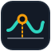
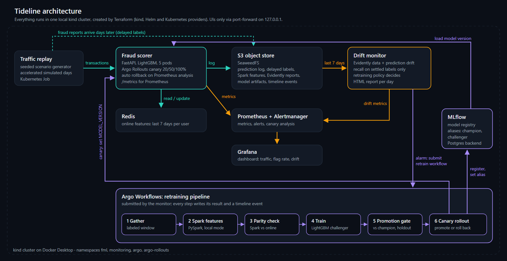

<p align="center"></p>

<h1 align="center">Tideline: a fraud model's whole lifecycle on Kubernetes</h1>

<p align="center">
Fraud patterns change, and a model trained last month quietly gets worse. This project runs a fraud model's whole lifecycle on a local Kubernetes cluster, catches the drift, retrains and safely rolls out a better model on its own, and measures whether that actually beats retraining on a schedule.
</p>

<!-- HERO -->

## Headline

<!-- HEADLINE -->

## Results

<!-- RESULTS -->

## Architecture



| Piece | What it does | Tech |
|---|---|---|
| Scenario generator | Seeded synthetic card transactions: 3,000 users, 5 fraud patterns, labels that arrive days later, drift switched on at a set day | numpy, pandas |
| Traffic replay | Replays a scenario in accelerated simulated days; it is the clock of the simulation | Kubernetes Job |
| Fraud scorer | Computes online features from Redis, scores with LightGBM, logs every request and score | FastAPI, Redis, Prometheus client |
| Canary rollout | Moves a new model from 20% to 50% to 100% of pods; aborts on errors, latency or flag rate | Argo Rollouts + Prometheus analysis |
| Drift monitor | Each simulated day: Evidently data and prediction drift, recall on settled labels only, retraining policy | Evidently, FastAPI |
| Retraining pipeline | Gather labeled window, Spark features, Spark-vs-online parity check, train, promotion gate, canary | Argo Workflows, PySpark, LightGBM, MLflow |
| Registry | Every version with a model card; aliases `champion` and `challenger` | MLflow (Postgres + S3) |
| Platform | kind cluster, Helm releases, secrets; `fml up` / `fml down` | Terraform, Helm |
| Observability | Dashboard and alert rules | kube-prometheus-stack (Prometheus, Grafana, Alertmanager) |

## Quickstart

Needs Docker Desktop (about 8 GB of memory for Docker), [uv](https://docs.astral.sh/uv/) and Git. Nothing else is installed system-wide: `fml up` downloads pinned, checksum-verified copies of kind, kubectl, helm, terraform and the Argo CLIs into `.tools/`.

```bash
uv sync
uv run fml up      # cluster + platform + images, about 15 minutes the first time
uv run fml demo    # one scenario end to end: replay, drift, retrain, canary (about 30 minutes)
```

Then open the dashboards (all bound to 127.0.0.1): Grafana on port 3000, Argo Workflows on 2746, Argo Rollouts on 3100, MLflow on 5000. `uv run fml down` deletes the cluster.

No cluster needed for the numbers: `uv run fml backtest --set test` reruns the policy comparison (resumable), `uv run fml results` recomputes every number from saved runs, and `uv run fml assets` redraws every chart and the site.

## How it works

<!-- HOW -->

## Things that went wrong

<!-- WRONG -->

## Limitations

<!-- LIMITS -->

## Cost to reproduce

$0. Everything runs locally in Docker Desktop: no cloud, no GPU, no API keys. <!-- COST -->

## License

MIT. All data is synthetic and generated by this repo.
