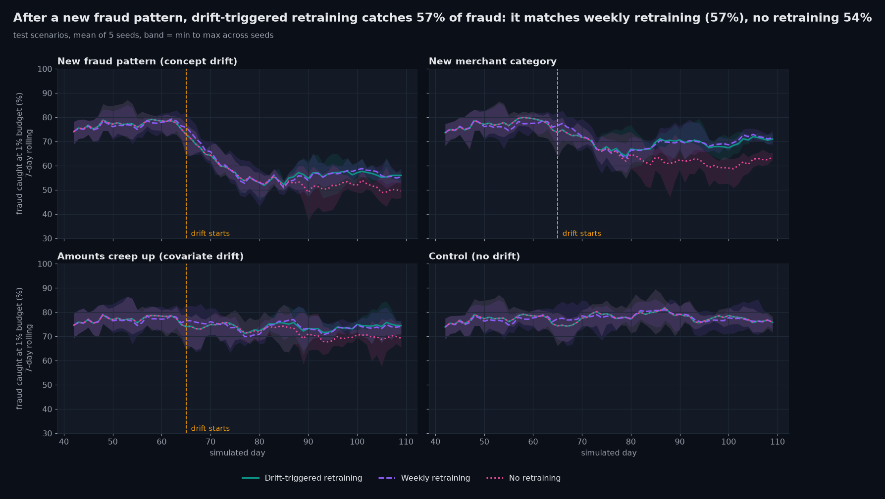
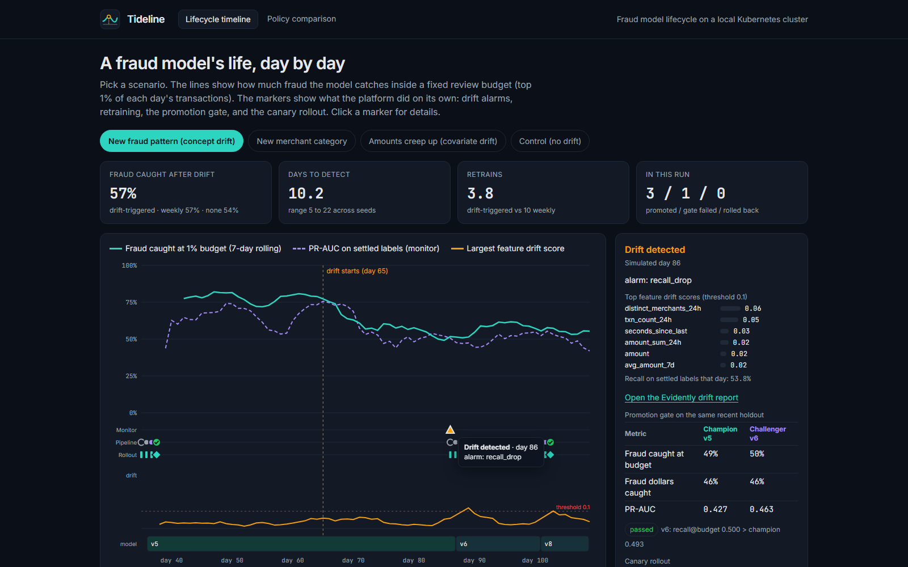
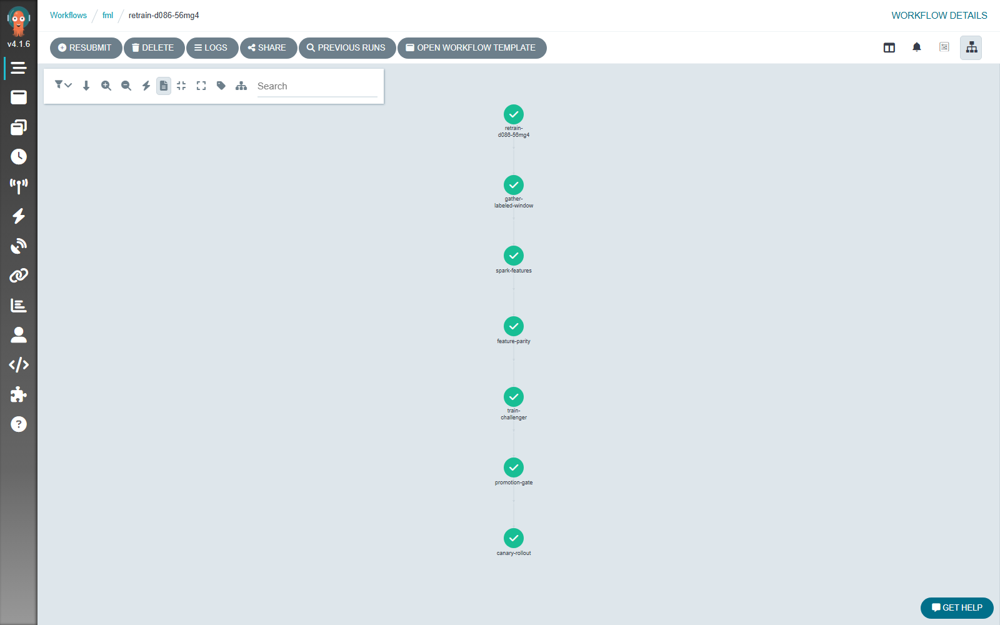
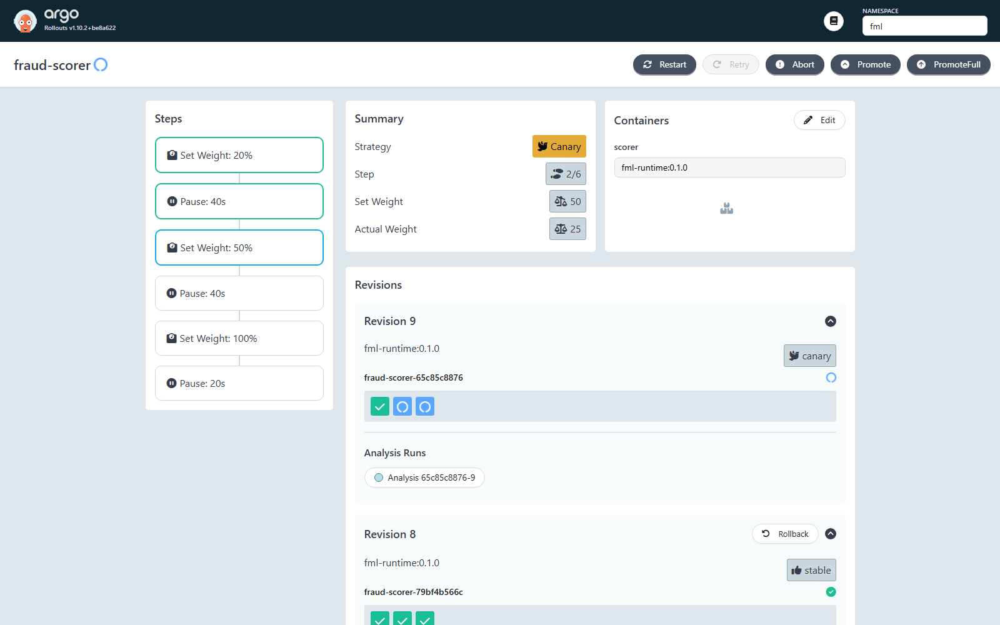
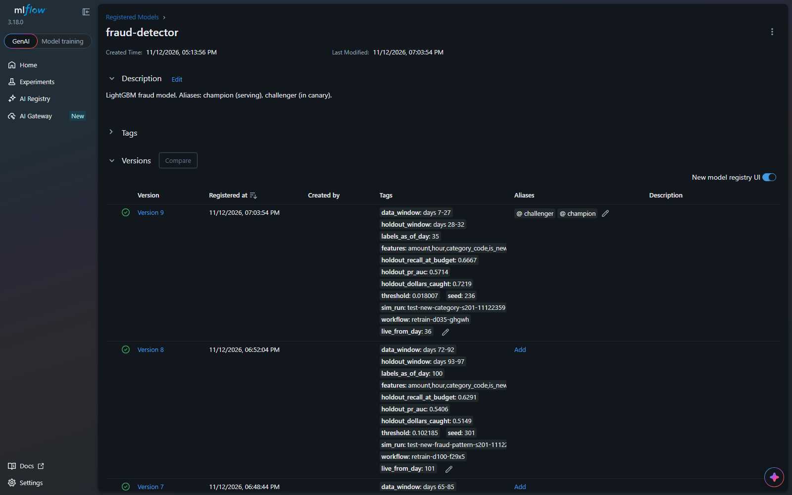
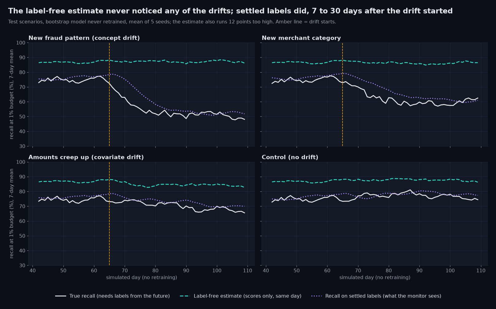

<p align="center"></p>

<h1 align="center">Tideline: a fraud model's whole lifecycle on Kubernetes</h1>

<p align="center">
Fraud patterns change, and a model trained last month quietly gets worse. This project runs a fraud model's whole lifecycle on a local Kubernetes cluster, catches the drift, retrains and safely rolls out a better model on its own, and measures whether that actually beats retraining on a schedule.
</p>

<p align="center"></p>

<p align="center"><a href="assets/video/walkthrough.mp4">Video (MP4)</a> · <a href="https://charlie-gzz.github.io/fraud-model-lifecycle/">Live results site</a> · <a href="results/summary_test.md">Full results table</a></p>

## Headline

> **When a new fraud pattern appeared, drift-triggered retraining recovered 13% of the lost fraud catch, the same as weekly retraining (13%); neither got back to 95% of the pre-drift catch before the run ended. It needed 3.8 retrains instead of 10, and 0 false retrains on the no-drift control (weekly retraining: 10).**

In short: drift-triggered retraining caught as much fraud as weekly retraining in every drift scenario, with 14 retrains instead of 40, and it never retrained when nothing had changed. It could not rescue a new fraud pattern faster than its labels arrive, and neither could weekly retraining.

## Results

Fast backtest on the **test** scenarios (5 seeds each, settings frozen on separate dev scenarios first). Mean across seeds; full table with min to max in [`results/summary_test.md`](results/summary_test.md).

| Scenario | Fraud caught after drift: drift-triggered | Weekly retraining | No retraining | Retrains: drift-triggered vs weekly | Time to detect |
|---|---|---|---|---|---|
| New fraud pattern (concept drift) | 56.7% | 56.6% | 53.6% | 3.8 vs 10 | 10.2 days (5 to 22) |
| New merchant category | 69.3% | 69.5% | 63.6% | 4.4 vs 10 | 8.0 days (8 to 8) |
| Amounts creep up (covariate drift) | 74.1% | 73.8% | 71.7% | 6.0 vs 10 | 5.2 days (5 to 6) |
| Control (no drift) | 77.9% | 77.9% | 77.9% | 0 vs 10 | 2 alarms, both inside the cooldown, so 0 retrains |

"Fraud caught" is recall inside the daily 1% review budget, pooled from the drift start (day 65) to day 109. Before drift, all policies catch about 77%.

What this says:
- **Same catch, far fewer retrains.** Drift-triggered retraining matched weekly retraining within 0.3 points in every scenario, with 14 retrains instead of 40 across the four (65% fewer), and none when nothing changed.
- **Where it does not help.** A new fraud pattern that looks like normal behavior barely moves the inputs (largest feature drift 0.02 to 0.04 when the alarm fires, against a 0.1 threshold). It is only caught when settled labels show recall falling, 5 to 22 days after it starts. By then neither policy can win back more than 13% of the lost catch: the new pattern is still a small, late-labeled share of the training window.
- **Feature drift is fast when it is real.** A new merchant category is flagged on day 8 in every seed, rising amounts on day 5 or 6. Prediction drift (the score distribution) never fired in any run.



### The same loop on the real platform

Each test scenario also ran once end to end on the Kubernetes cluster (seed 201): the replay sends every transaction through the scorer, the monitor raises alarms, Argo trains and gates challengers, and Argo Rollouts canaries them. The cluster and the fast backtest share code, data and seeds, so they should make the same decisions:

| Scenario (seed 201) | Retrain days: cluster | Retrain days: backtest | Fraud caught after drift: cluster vs backtest |
|---|---|---|---|
| New fraud pattern | 86, 93, 100 | 87, 94, 101 | 56.6% vs 56.5% |
| New merchant category | 73, 80, 87, 94 | 73, 80, 87, 94, 101 | 72.3% vs 71.4% |
| Amounts creep up | 70, 77, 84, 91, 98, 105 | 70, 77, 84, 91, 98, 105 | 73.5% vs 73.4% |
| Control (no drift) | none | none | 77.1% vs 76.6% |

Same retrain days in two scenarios; one day earlier on the new fraud pattern; one fewer follow-up on the new category. Promotion-gate outcomes differ on a few close calls (details in [`results/fullloop/agreement.md`](results/fullloop/agreement.md)). Fraud caught agrees within 0.9 points everywhere.

Small gaps are expected: on the cluster a canary splits the next day between two model versions, and Spark's float sums differ from numpy's in the last bits (max feature difference 4e-12 over 17 retrains), which can flip a close promotion-gate call.



| Argo Workflows: one retrain | Argo Rollouts: canary at 50% | MLflow: versions, aliases, model card |
|---|---|---|
|  |  |  |

| Also measured | Result |
|---|---|
| Canary safety | A deliberately broken model (binary expects 11 features, metadata says 12) was rolled back by the Prometheus error-rate analysis in 52 s; the champion kept serving ([`results/cluster/broken_model_rollback.json`](results/cluster/broken_model_rollback.json)) |
| Scorer latency | 424 requests/s, p50 34 ms, p95 67 ms, 0 errors (single-transaction requests, 5 pods, laptop) ([`results/cluster/loadtest.json`](results/cluster/loadtest.json)) |
| Platform memory | about 4.0 GB idle, peak 8.6 GB during a full-loop run (`docker stats` on the kind node) |

## Beyond the plan: can you skip the label wait?

Labels arrive days late, so a natural idea is to estimate recall from the model's own probabilities (confidence-based estimation): expected frauds caught = sum of flagged scores, divided by the sum of all scores. [`src/fml/stretch/label_free.py`](src/fml/stretch/label_free.py) tests it on the test scenarios with no retraining.



It never noticed any of the three drifts and ran about 12 points too high throughout. The reason is the same one that makes the new fraud pattern hard: the model is confident about what it has seen, and new fraud looks normal to it. Settled labels were slow (7 to 30 days to show a 5-point drop) but right. The cloud-ready Terraform layout ([`infra/cloud-example`](infra/cloud-example/main.tf), validate only, never applied) shows the platform code does not depend on kind.

## Architecture


| Piece | What it does | Tech |
|---|---|---|
| Scenario generator | Seeded synthetic card transactions: 3,000 users, 5 fraud patterns, labels that arrive days later, drift switched on at a set day | numpy, pandas |
| Traffic replay | Replays a scenario in accelerated simulated days; it is the clock of the simulation | Kubernetes Job |
| Fraud scorer | Computes online features from Redis, scores with LightGBM, logs every request and score | FastAPI, Redis, Prometheus client |
| Canary rollout | Moves a new model from 20% to 50% to 100% of pods; aborts on errors, latency or flag rate | Argo Rollouts + Prometheus analysis |
| Drift monitor | Each simulated day: Evidently data and prediction drift, recall on settled labels only, retraining policy | Evidently, FastAPI |
| Retraining pipeline | Gather labeled window, Spark features, Spark-vs-online parity check, train, promotion gate, canary | Argo Workflows, PySpark, LightGBM, MLflow |
| Registry | Every version with a model card; aliases `champion` and `challenger` | MLflow (Postgres + S3) |
| Platform | kind cluster, Helm releases, secrets; `fml up` / `fml down` | Terraform, Helm |
| Observability | Dashboard and alert rules | kube-prometheus-stack (Prometheus, Grafana, Alertmanager) |

## Quickstart

Needs Docker Desktop with at least 10 GB of memory (the cluster peaks at 8.6 GB), [uv](https://docs.astral.sh/uv/) and Git. Nothing else is installed system-wide: `fml up` downloads pinned, checksum-verified copies of kind, kubectl, helm, terraform and the Argo CLIs into `.tools/`.

```bash
uv sync
uv run fml up      # cluster + platform + images, about 15 minutes the first time
uv run fml demo    # one scenario end to end: replay, drift, retrain, canary (about 30 minutes)
```

Then open the dashboards (all bound to 127.0.0.1): Grafana on port 3000, Argo Workflows on 2746, Argo Rollouts on 3100, MLflow on 5000. `uv run fml down` deletes the cluster.

No cluster needed for the numbers: `uv run fml backtest --set test` reruns the policy comparison (resumable), `uv run fml results` recomputes every number from saved runs, and `uv run fml assets` redraws every chart and the site.

## How it works

1. **Data.** A seeded generator makes 110 days of card transactions for 3,000 users (about 4,700 a day). Five fraud patterns: card testing, account takeover (a third from the victim's own hijacked phone), quiet single stolen-card purchases, and two that only appear with drift: a scam paid from the victim's own phone at new merchants, and cash-outs in a new crypto category. Legit look-alikes (in-app purchase bursts, new phones, the odd big purchase) keep the problem honest: about 77% recall at the budget before drift, not 99%.
2. **Delayed labels.** Fraud is reported 0.5 to about 10 days after it happens (median 2). A day counts as "settled" 3 days later. Training, the promotion gate and the monitor's recall only use labels that would have arrived by that simulated day.
3. **Features.** Twelve features: amount, hour and merchant category, plus per-user history (counts and sums over 1 hour, 24 hours and 7 days, distinct merchants, amount vs the user's 7-day average, new device, merchant not used in 7 days, time since last transaction). One definition, three implementations: Spark for training, Redis for serving, numpy for the fast backtest. Every retrain checks Spark against the features the scorer actually used.
4. **Serving.** FastAPI scores each transaction with LightGBM, flags the top 1% of scores (the analysts' daily review budget), exports Prometheus metrics, and logs every request to S3.
5. **Monitoring.** At the end of each simulated day the monitor compares the last 7 days of traffic with the champion's training data using Evidently (Wasserstein for numbers, Jensen-Shannon for categories, threshold 0.1), checks the score distribution, and measures recall on settled labels.
6. **Retraining policy.** Retrain when a feature drifts for 3 days in a row, the score distribution drifts, or settled-label recall drops 15 points below the champion's holdout recall. At most once a week, plus two weekly follow-up retrains after an alarm, because labels for a new pattern keep arriving for weeks.
7. **Pipeline.** An Argo Workflow gathers the labeled window, builds features with Spark, checks parity, trains a LightGBM challenger on 21 settled days, and compares it with the champion on the 5 most recent settled days. Only a challenger that catches more fraud at the budget passes. It is registered in MLflow with a model card and the `challenger` alias.
8. **Canary.** The workflow points the Argo Rollout at the new version: 20%, 50%, then 100% of pods, while Prometheus analysis watches error rate, p95 latency and flag rate. A failure rolls back automatically. Success moves the `champion` alias.
9. **Policy comparison.** The fast backtest runs the same windows, policy, drift check, training and gate in-process, so every scenario x policy x seed runs in minutes. Settings were tuned on dev scenarios and frozen before the test scenarios (different seeds and drift timing) were run.

## Things that went wrong

- **MinIO is gone.** Its container images are no longer published, so the S3 store is SeaweedFS. The code only sees an S3 endpoint.
- **MLflow ate 1.9 GB and got OOM-killed.** MLflow 3's server starts eight job-runner processes by default. One environment variable (`MLFLOW_SERVER_ENABLE_JOB_EXECUTION=false`) brings it to 360 MB.
- **The first synthetic data was too easy.** 99% recall at a 1% budget is not believable. Harder fraud and legit look-alikes, tuned on dev data only, brought it to about 77%.
- **"Retrain on drift" lost to "retrain weekly" at first.** It retrained once and went quiet, while labels for a new fraud pattern arrive over weeks. Follow-up retrains fixed the cause. Both versions are kept in `results/archive/`.
- **A feature looked like drift on the control.** "Never used this merchant before" keeps falling as simulated histories fill up, so the monitor fired 4 to 17 false alarms per dev run. Redefining it as "not used in the last 7 days" and requiring 3 days of persistence removed nearly all of them.
- **The full loop caught a bug the backtest could not.** The monitor service saved its policy state only when it started a retrain, so the 3-day drift streak reset every simulated day and data-drift alarms never fired on the cluster (110 days of a new merchant category, no alarm). The backtest keeps state in memory, so it was fine. Fixed, regression test added, affected runs rerun.
- **The object store ran out of memory** when the monitor read hundreds of small prediction-log files at once. The limit went from 384 MB to 1 GB.

## Limitations

- **Synthetic data.** The fraud patterns and drift are designed, not observed. Real fraud adapts to the model, which this simulation does not.
- **One laptop cluster.** Single-node kind, single replicas, no high availability. Latency numbers are for this setup only.
- **Canary by pod count.** Without a service mesh, "20% of traffic" means 1 of 5 pods. Fine for a demo, coarse for production.
- **Simulated clock.** The replay is the clock, and it pauses while a retraining workflow trains. In production, traffic would keep flowing during training.
- **Small daily fraud counts** (about 20 a day) make daily recall noisy. Results pool days and report the spread over seeds.
- **Label model is simple.** Delays are i.i.d. and fraud never gets reported as legit. Real chargeback data is messier.
- **One seed per full-loop run.** The 5-seed numbers come from the fast backtest; the cluster runs (seed 201) check that the two agree.
- **Prediction drift was never the signal.** In every scenario, alarms came from feature drift or the recall drop.

## Cost to reproduce

$0. Everything runs locally in Docker Desktop: no cloud, no GPU, no API keys. Peak memory of the kind node was 8.6 GB during full-loop runs (Docker Desktop had 15.6 GB). Images: runtime 1.8 GB, Spark 1.9 GB, MLflow 1.4 GB. A full-loop run takes 20 to 45 minutes; the 60-run backtest about 40 minutes on 12 cores.

## License

MIT. All data is synthetic and generated by this repo.
